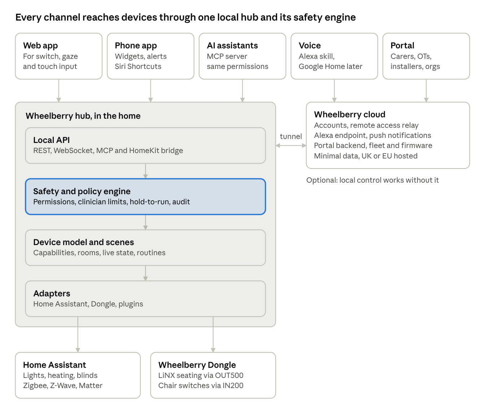
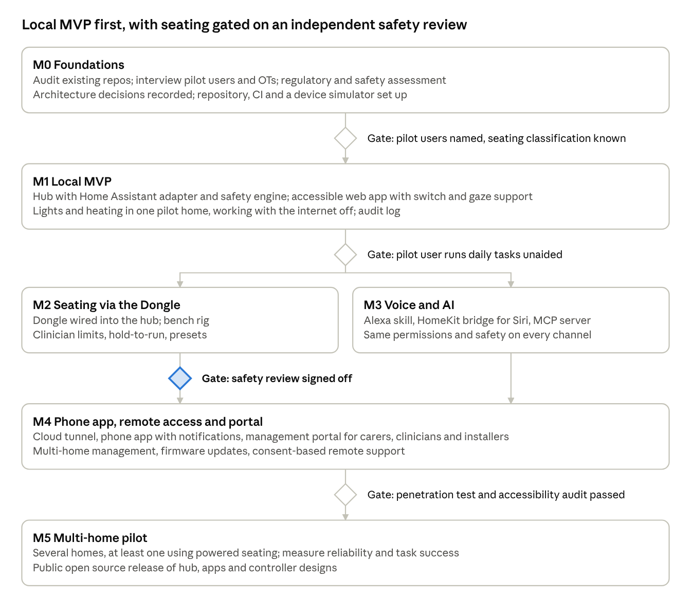

# Wheelberry: Spec, Architecture and Milestones

Draft for discussion. Agreed 11 October 2026; **reconciled with the four decision records on 18 October 2026.**

This file began as a snapshot of the working [Claude Doc](https://claude.ai/code/artifact/7fb1cfd2-8184-444a-9efe-f79792d1fc75). It is no longer a snapshot: the reconciliation below was applied here and has not been applied there, so **this file is ahead of the Claude Doc.** Either port these changes back or retire the artifact as the working copy — two editable copies of the same spec is the problem this pass exists to fix.

Requirements have moved. [requirements.md](requirements.md) is the authoritative register of F1–F32 and the numbered non-functional requirements; the sections below carry titles only. The reasoning behind each decision lives in [movement-semantics.md](movement-semantics.md), [home-assistant-decision.md](home-assistant-decision.md), [audit-retention.md](audit-retention.md) and [spec-review.md](spec-review.md).

## Mission and principles

> Wheelberry gives disabled people simple, safe and secure control of the technology around them, from wheelchair seating and beds to lights, heating and Home Assistant, using whichever method suits them: touch, voice, phone or AI assistant. Users shape their own setup, with carers and support teams helping through a shared management portal. Wheelberry is open source and affordable, so it works with what people already own. Wheelberry does not drive wheelchairs; it controls seating and the environment around the user.

Richard agreed this mission on 11 October 2026. The principles below turn it into design rules.

1. **Safety is the headline promise.** Anything that moves a person (seat tilt, recline, leg rests, beds, hoists) has limits a clinician sets and fail-safes that release movement if control is lost, and stop always wins. Wheelberry never drives a wheelchair.
2. **The user is in charge of their setup.** Users decide what is controlled, how, and who else can help. Carers and support teams work through the same shared portal, with the access the user gives them.
3. **One device model, many front-ends.** Every device is described once, as capabilities (on/off, level, position, temperature). Touch, voice, phone and AI channels are thin adapters over that model, so a new device appears everywhere at once. One safety engine serves all of them — but they are not equally capable: what a channel may *command* is limited per channel, by capability class, and a channel that may not do something refuses it with a reason.
4. **Accessibility first.** The user interface meets WCAG 2.2 AA as a floor and supports switch access, scanning, large targets, eye gaze and screen readers. Every action is reachable by more than one input method.
5. **Local first.** Core control works inside the home with no internet. The cloud adds remote access, voice assistants and the portal, never a dependency for switching on a light.
6. **Secure and private by default.** Least-privilege access per user and device, encrypted everywhere, minimal data leaving the home.
7. **Open source and affordable.** Works with equipment people already own (their chair's control system, their bed, Home Assistant, Matter devices) on low-cost hardware. New device types arrive as plugins.

## Users

Six kinds of people touch Wheelberry; the disabled end user is the one every decision is tested against.

| User | Who they are | What they need from Wheelberry |
| --- | --- | --- |
| End user | A disabled person with any mix of motor, speech, vision or cognitive impairment | Reliable, fast control through the input method that works for them, clear feedback that an action happened, and ownership of their own setup |
| Carer or family member | Helps day to day, at home or remotely | Shared control where the user allows it, alerts when something needs attention |
| Clinician (OT, seating specialist) | Prescribes and reviews seating and positioning | Set safe ranges and presets for powered seating; review usage |
| Installer or integrator | Fits hardware and configures the home | Device discovery, layout building, diagnostics, firmware updates |
| Organisation admin | Runs a care provider, charity or housing association with many homes | Manage many sites and staff, audit who did what |
| Developer | Contributes integrations or hardware designs | Documented APIs, a plugin model, a simulator to test against |

## Scope

Wheelberry controls wheelchair seating, beds and common home devices; it never drives a wheelchair, which is safety-critical in a different class.

### What Wheelberry controls

| Device class | Examples | How Wheelberry reaches it | Release |
| --- | --- | --- | --- |
| Home control | Lights, heating, blinds, plugs, door openers, TV | Through a home-device **backend adapter** (F22). Home Assistant is the first backend, and already speaks Zigbee, Z-Wave, Matter, Wi-Fi and hundreds of vendor APIs; a direct IP API may be implemented instead, case by case, against the test in the HA decision record | M1 |
| Open source platforms | Home Assistant, plus Node-RED and openHAB later | Two-way, but asymmetric. Wheelberry **uses** Home Assistant as a backend, and **appears inside** it for read and non-movement control only — movement of a person is refused with a reason (F21, P9) | M1 (Home Assistant only) |
| Bespoke hardware | Wheelchair seat tilt, recline, leg rests, bed or hoist controls | The Wheelberry Dongle, which drives and reads the chair's own LiNX auxiliary modules; Bedberry for electric beds | M2 |

### How people control it

| Channel | Approach | Release |
| --- | --- | --- |
| User web page | Installable progressive web app, built for switch, scanning, eye gaze and touch | M1 |
| Voice: Alexa | Alexa Smart Home skill via the Wheelberry cloud | M3 |
| Voice: Siri | Hub exposes devices to Apple Home (HomeKit bridge), plus Siri Shortcuts from the phone app | M3 |
| Phone app | Native shell around the web app, adding widgets, notifications and Shortcuts | M4 |
| AI assistants | A Model Context Protocol (MCP) server so Claude and similar assistants can see and control devices, under **a constrained subset** of the user's permissions (F18, A1–A6) | M3 |
| Management portal | Web portal for carers, clinicians, installers and organisations | M4 |

**Channels are not equivalent, and that is deliberate.** Which capability classes each channel may command is set by the channel capability matrix in [movement-semantics.md](movement-semantics.md), which is authoritative over both tables above. A channel that may not perform an action refuses it with a reason rather than hiding it (F2).

Siri is current, at M3 alongside Alexa, with Google Home later. `images/architecture.png` disagrees — it reads "Alexa skill, Google Home later" and omits Siri — and needs regenerating.

### Out of scope for now

- Wheelchair driving and propulsion.
- Medical monitoring or clinical alerts (falls, vital signs).
- Building our own home-automation protocols or radios. **The line is the radio, not the integration:** Zigbee, Z-Wave, Thread and Matter stacks stay out of scope, while a device's own IP API on the LAN may be implemented directly, case by case, against the four-part test in [home-assistant-decision.md](home-assistant-decision.md).

## Existing work

The restart keeps the Wheelberry Dongle (hardware, firmware and test site) and Bedberry's bed control ideas. The wheelberry monorepo is old work in progress, so the plan is to reuse parts of it rather than build on it. Richard named the first four repositories below as the ones that matter.

| Repository | What it is | State | Plan |
| --- | --- | --- | --- |
| [pcb\_wheelberry\_dongles](https://github.com/DarwinInnovation/pcb_wheelberry_dongles) | KiCad design for the dongle boards (DSUB-9, 3.5 mm jack) that connect to LiNX auxiliary modules | Initial commit, March 2026 | Keep |
| [wheelberry\_dongle\_http\_test\_site](https://github.com/DarwinInnovation/wheelberry_dongle_http_test_site) | Local Python web server that works with the dongles. Hold-to-run seat buttons, plus actions triggered from chair inputs | Most recent (8 Oct 2026); 300 ms watchdog with 100 ms resend | Keep its fail-safe model as the reference; port it into the hub |
| [wheelberry](https://github.com/DarwinInnovation/wheelberry) | Old work in progress: TypeScript monorepo with cloud proxy (Express, Socket.IO, MongoDB), Alexa skill with Amazon login, React portal, blanket and stub wheelchair clients | Consolidated April 2026; wheelchair transport is a stub | Reuse parts (Alexa account linking, portal shell); start the hub fresh. **Account linking is coupled to MongoDB user and token models and the cloud plan specifies Postgres**, so "reuse" here means a port with a data-model rewrite, not a lift |
| [bedberry](https://github.com/DarwinInnovation/bedberry) | Raspberry Pi Zero 2W board for Okin electric beds: buttons and pressure pads, Alexa, and a tilt sensor for angle presets ("sit up" goes to 60 degrees) | 2022; PCB with manufacturing files, TypeScript software | Bring beds in as a device class. Its tilt sensor is **not** the model for seating presets — see the note below and F15 |
| [firmware\_wheelberry\_output\_module](https://github.com/DarwinInnovation/firmware_wheelberry_output_module) | STM32H523 USB module driving a LiNX DLX-OUT500 (6 digital outputs, 2 analogue) | v2 fail-safe merged 8 Oct 2026; unit tests | Keep |
| [firmware\_wheelberry\_input\_module](https://github.com/DarwinInnovation/firmware_wheelberry_input_module) | STM32H523 USB module reading a LiNX DLX-IN200 (8 inputs) | Version 1, April 2026 | Keep; adds a new channel, the chair's own switches |
| node-wheelberry-proxy, -proxy-client, -wheelchair, -blanket | Earlier copies of the monorepo apps | Each says it moved to the monorepo | Archive |
| [node-wheelberry-i2c](https://github.com/DarwinInnovation/node-wheelberry-i2c) | MCP23017 I2C library for the 2022 boards | Dependency updates only | Archive unless the Pi boards return |

Two things in the existing code need changing:

- The Alexa wheelchair skill moves the seat for a spoken number of seconds ("tilt up 5 seconds"), with no hold-to-run. A timed open-loop move is now the **only** kind of preset available (position sensing is deferred — movement-semantics decision 1), so the skill's mechanism is not the problem; its lack of guards is. What it needs is the run-time cap (N-S3), the clinician opt-in, the pre-announcement and cancel window, and the audit record — F17 and P1–P8 — not a rewrite to measured positions. The earlier advice to copy Bedberry's angle sensing is **withdrawn**: it assumed hardware we do not have, and F15 exists precisely to stop that assumption reappearing.
- A personal email address is in the public monorepo in **both** `apps/proxy/cfg/wheelchair.json5` and `apps/proxy/cfg/blanket.json5`, and it is in git history. Moving it to an untracked config file fixes HEAD only; removing it from history is a separate, deliberate decision.

## Requirements

**The normative text lives in [requirements.md](requirements.md), not here.** Keeping a second copy in this file is how the contradictions this pass fixed arose in the first place, so what follows is an index by title only. Where a title and the register ever disagree, the register wins.

**Functional — devices and control**

| ID | Title | |
| --- | --- | --- |
| **F1** | Typed capability model, grouped by room | |
| **F2** | Any action permitted *on that channel*, from any enabled channel, same policy evaluation | Revised |
| **F3** | State reported back to every channel, including failures and refusals | Revised |
| **F4** | Scenes and routines, by one action and on a schedule; a routine that moves a person satisfies F17 | Revised |

**Personalisation and access**

| ID | Title | |
| --- | --- | --- |
| **F5** | Per-user profile: input method, scanning speed, layout, text size, contrast, voice phrases, locale | Revised |
| **F6** | Simple per-person control layouts, few large targets by default | |
| **F7** | Permissions per user, per device, per channel, for every action through a Wheelberry channel | Revised |

**Safety for moving equipment**

| ID | Title | |
| --- | --- | --- |
| **F8** | Clinician configuration enforced, recording whether Wheelberry or the chair enforces each limit | Revised |
| **F9** | Every movement of a person has a recorded stop authority: hold-to-run, attended bounded run, or compliant unattended run | Revised |
| **F10** | Safety stop independent of software; local stop from every local channel; convenience stop best-effort | Revised |
| **F15** | Unmeasured axes bounded by time and the chair's own range; no nominal preset presented as measured | New |
| **F16** | Installer service mode: no occupant, time-limited, physical presence, audited | New |
| **F17** | Unattended movement only under P1–P9 | New |
| **F18** | AI assistants: named presets, own opt-in, unattended class, audited. Qualified by A1–A6 | New |
| **F23** | Movement exclusive per axis by lease; stop never exclusive; unattended yields to any human | New |

**Platform, backends and resilience**

| ID | Title | |
| --- | --- | --- |
| **F19** | The hub owns its own lifecycle and process | New |
| **F20** | Seating, chair input, local stop and the hub's own UI work with any home-device platform absent | New |
| **F21** | Devices exposed into a third-party platform are read and non-movement only; movement refused with a reason | Revised |
| **F22** | One capability model behind backend adapters; exactly one backend owns a device; no automatic failover | New |
| **F24** | Degraded mode defined: offline changes, buffered audit, ended remote sessions, command staleness limit | New |

**Lifecycle, management and record-keeping**

| ID | Title | |
| --- | --- | --- |
| **F11** | Onboard a home: discover devices, connect backends, pair controllers | Revised |
| **F12** | Users, roles and organisations across many homes | |
| **F13** | Health monitoring, firmware updates, consented remote support | |
| **F14** | Audit log of every action through a Wheelberry channel, logged alike whoever acted, stating what it does not cover | Revised |
| **F25** | Whole pairing lifecycle: key rotation, revocation, decommissioning, transfer to a new user | New |
| **F26** | Six record classes, each with a retention period, a lawful basis, and class, expiry and tier stamped at write time | Revised |
| **F29** | Controller and processor determined per deployment shape; erasure requests answered or routed, never silently refused | New |
| **F30** | Append-only, tamper-evident audit log with per-subject encryption, so erasure is key destruction | New |
| **F31** | In-product view of everything held about the user, with who has read it; disclosure before seating is enabled | New |
| **F32** | Read access to audit records enforced per class and per role, separately from permission to act; reads are audited | New |

**Development and reach**

| ID | Title | |
| --- | --- | --- |
| **F27** | Device and controller simulator with fault injection, no hardware present | New |
| **F28** | Every user-facing string externalised; locale per user | New |

**Non-functional.** Numbered in the register in eight groups, so tests and issues can trace to them the way they trace to the F-series: **N-S** safety (7), **N-SEC** security (6), **N-A** accessibility (4), **N-P** performance (3), **N-R** reliability (4), **N-D** data protection (5), **N-REG** regulatory (3), **N-O** openness (2) — thirty-four in all. Safety and accessibility are pass/fail gates for every release.

Two of them are worth knowing from this document: **N-P1** is 150 ms input-to-command on the seating path, and **N-S1** is the 300 ms watchdog release. They were a single "under 300 ms" line here and are unrelated things — one is how responsive movement feels, the other is how fast outputs drop when commands stop.

## Proposed architecture

A small hub in each home owns the device model and the safety rules; every channel, local or cloud, goes through it, so a rule written once applies everywhere.

The web app, phone app and AI assistants talk to the hub directly on the home network, or through the cloud tunnel when away. Alexa and the portal always go through the cloud. The hub opens the tunnel outbound, so no ports are opened on the home router. Reaching the hub is not the same as being allowed to command it: what each of these channels may do is set by the capability matrix in [movement-semantics.md](movement-semantics.md).

**Key decision: Home Assistant is a backend Wheelberry depends on, not the platform Wheelberry runs on.** A backend is something you call and can survive the absence of; a platform owns your lifecycle, your updates and your failure modes. Home Assistant already integrates thousands of home devices, and Wheelberry adds what it lacks: accessible interfaces, per-user permissions, safety for moving equipment, multi-channel control and multi-home management. But the hub runs **standalone only — there is no Home Assistant add-on build** (F19), an install with no Home Assistant at all is supported and controls both seating and lighting (F20), no safety path ever traverses Home Assistant, and Home Assistant is one home-device backend among several rather than the only one (F22). Decided 18 October 2026; the reasoning, the options rejected and the nine consequences are in [home-assistant-decision.md](home-assistant-decision.md).

**Bespoke hardware** is the existing Wheelberry Dongle: STM32 input and output modules on USB, driven by a small Linux host on the chair. The output module drives the chair's LiNX DLX-OUT500 seating module and releases every output if commands stop arriving. The input module reads the LiNX DLX-IN200, so the chair's own switches can trigger Wheelberry actions. The chair's own end-stops and limits stay in force.

| Part | Proposed technology | Reason |
| --- | --- | --- |
| Hub | TypeScript on Node.js, SQLite; Raspberry Pi 5 | Decided by Richard, 11 October 2026. Other tools and services may be Python, as much existing Darwin Innovation software is. The add-on option is withdrawn (F19) |
| Web app and portal | React progressive web app | One codebase for desktop, tablet and phone |
| Phone app | Native shell (Capacitor or React Native) around the web app | Adds widgets, notifications and Siri Shortcuts cheaply |
| Controller firmware | Existing STM32H523 dongle firmware over USB serial; the link from dongle host to hub is still to decide | Already built, with a tested fail-safe |
| Cloud | Containerised services with Postgres, UK or EU region | Standard, portable, meets data residency |
| Voice | Alexa Smart Home Skill API; HomeKit bridge on the hub for Siri | Official routes with device-style control |
| AI assistants | MCP server over the hub's local API | Works with Claude and other MCP clients under **a constrained subset** of the user's permissions — named presets, its own clinician opt-in, unattended treatment, full audit (F18, A1–A6) |

## Milestones

Six milestones take Wheelberry from research to a multi-home pilot; the local M1 build comes first because it proves the core with no safety risk, and seating waits for its own safety gate.

Seating (M2) and voice and AI (M3) can run side by side once M1 passes its gate. No dates are set yet; they depend on team size and budget, which are open questions below. Milestone numbers M0–M5 are now the only release names used in this document; "MVP", "second release", "release 3" and "release 4" have been retired from the tables above.

**The gates are stated measurably in [requirements.md](requirements.md)**, including the M1 gate in full — the task list agreed with the pilot user and their OT *in M0, before any M1 code*, and the thresholds for passing it. M1 also carries sixteen of the thirty-four non-functional requirements, and four functional requirements about the shape of the audit log, which is a larger M1 than "lights and heating in one home" suggests.

`images/roadmap.png` needs regenerating. Its M3 caption reads "Same permissions and safety on every channel": the same safety *engine*, yes, but not the same permissions — per-channel capability limits are the deliberate design, so the wording needs to be something like "One safety engine, per-channel capability limits". M3 also has no gate drawn; one is proposed in the register.

## Risks and open questions

The biggest risk is the wheelchair seating work: it is the most valuable feature and the only one that can hurt someone.

| Risk | Mitigation |
| --- | --- |
| A software or network fault moves a seat unexpectedly | Hardware interlocks and stop circuit, hold-to-run, clinician limits, bench and user testing before any pilot |
| The dongle only fits LiNX chairs | Keep seating behind the capability model, so other makers' auxiliary interfaces can be added later |
| Seating controller counts as a medical device | Regulatory assessment in Milestone 0, before hardware design is fixed |
| Voice platforms change rules or APIs | Keep voice adapters thin; core control never depends on them |
| Building for many disabilities at once dilutes the product | Pick one or two pilot users and design with them first |
| Home Assistant is hard for non-technical installers | A preconfigured hub is **the supported path** for this user, not a mitigation to consider — it is now the one-box story, since there is no add-on build. Whether that box also runs Home Assistant is an M1 packaging decision, and its criterion is N-S2 measured in that configuration under recorder load |

### Accepted hazards and accepted privacy risks

Three things are accepted with controls rather than eliminated — two safety hazards and one privacy risk. They are recorded here, not only in the decision records, so that the independent safety reviewer at the M2 gate and the DPIA reviewer see them declared rather than find them.

| Accepted hazard | Why it is accepted | Controls |
| --- | --- | --- |
| **Prompt injection against an assistant with movement access** | AI movement was permitted deliberately (movement-semantics decision 4). An assistant can be argued into acting by whatever lands in its context, and no filter closes this | F18 and A1–A6: named presets only, separate clinician opt-in, unattended envelope unless a present human holds the stop, no retries, the originating utterance in the audit log |
| **Entrapment that cannot be detected** | With no position sensing and no motor-current sensing, there is no signal that a limb or object is trapped | Every position in an axis's configured travel must be safe to occupy (F15), run-time caps, per-axis clinician acceptance of the residual risk (P7), and the open hardware question of whether motor current or stall detection can be added |
| **A complete record of the user's own activity** | Every action is logged alike, by decision (audit retention, decision 1). For a user whose every interaction with their home passes through Wheelberry, that is a near-continuous record of when they wake, sleep, eat, go out and are alone — which an able-bodied person's home does not produce | Read access enforced per class and per role, with reads themselves audited and visible to the user (F32); the own-action record used only to show the user their own history and to diagnose faults, never for analytics, research or disclosure to an organisation; deleted in full and immediately on request (N-D3); and disclosed in the onboarding flow (F31) |

### Open questions for Richard

- [ ] Who are the first pilot users, and which input methods do they rely on?
- [ ] Beyond LiNX, which wheelchair control systems matter?
- [x] Do you agree wheelchair driving is out of scope? Yes, decided 11 October 2026.
- [x] Should Wheelberry sit on top of Home Assistant or stand alone? **Stand alone**, decided 18 October 2026 — see [home-assistant-decision.md](home-assistant-decision.md). Home Assistant stays as a backend, and is no longer the only one.
- [ ] Is this an open source project, a product, or both? Which licence? (N-O1 wants this by M0)
- [ ] Who is the team, and is there a budget or deadline that milestones should fit?
- [ ] Who runs the cloud side, and is UK or EU hosting a requirement?
- [ ] Are care organisations managing many homes an early customer, or later? Either way, N-REG3 now gates the first organisational sale.

### Opened by the review

- [x] **Audit retention periods and the erasure answer** — decided 18 October 2026; see [audit-retention.md](audit-retention.md). Six record classes, every action logged alike, Article 9(2)(i) with 9(2)(f) for the tail, retention differentiated by tier, and a data-protection specialist engaged before the first organisational sale (N-REG3).
- [ ] **Does the dongle or LiNX path expose motor current or stall detection?** With no position sensing, current is the only entrapment signal there could be. Cheap to add now, expensive later.
- [ ] **Per axis, is the full configured travel safe to occupy unattended, indefinitely?** A clinician and installer judgement, once per user, and a precondition for F17 on that axis (P2).
- [ ] **Can LiNX range limits be programmed per user at installation?** If not, unattended movement is all-or-nothing per axis.
- [ ] **Does the preconfigured hub run Home Assistant on the same box?** M1 packaging; decided on N-S2 measured in that configuration.
- [ ] **Which wheelchair control systems beyond LiNX matter?** Already above, and now also gating how far the capability model has to stretch.
